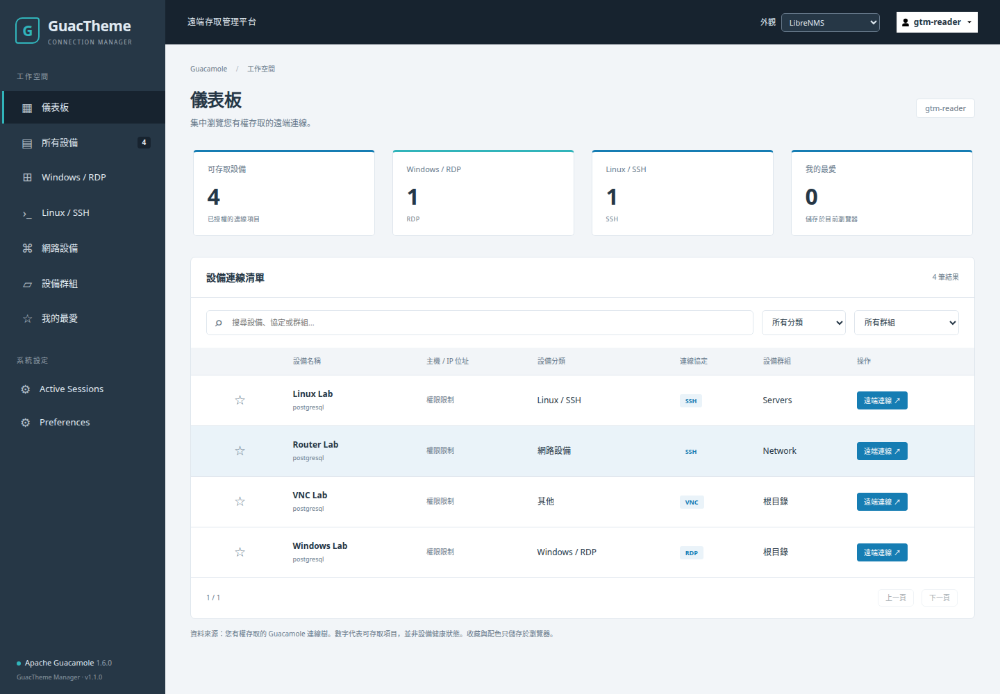

# GuacTheme Manager

適用 **Apache Guacamole 1.6.0** 的可安裝主題與管理 CLI。使用官方 JAR 擴充機制載入 CSS、JavaScript、HTML patch；不修改 WAR，不增加後端服務，不操作正式 PostgreSQL。

[English](README.en.md) · [安裝與還原](docs/INSTALL.md) · [主題規格](docs/THEMES.md) · [相容性與設計依據](docs/ARCHITECTURE.md) · [測試與人工驗收](docs/TESTING.md) · [Release 發布](docs/RELEASING.md)

[1.1.0 系統設定頁面與驗證紀錄](docs/SETTINGS-1.1.md)

[PAM 原創系統規劃與代理實作指南（TXT）](docs/PAM_SYSTEM_PLAN.zh-TW.txt) · [首批實作與試點操作（TXT）](docs/PAM_PILOT_RUNBOOK.zh-TW.txt)

[PAM 逐項驗收與日期進度表（152 項 TXT）](docs/PAM_ACCEPTANCE.zh-TW.txt)

[Git 發佈範圍與實際設定排除（TXT）](docs/GIT_PUBLICATION.zh-TW.txt)：只分享程式碼與通用文件；下載原始碼後先執行 `python3 scripts/build.py`。實際帳號、設備、密碼、資料庫及部署設定不隨 Git 提供。

已接續建立 [G01 最小 Java 連線攔截探針（TXT）](docs/PAM_G01_PROBE.zh-TW.txt)：21 項伺服器與 5 項瀏覽器檢查通過。此探針只用於隔離測試，正式 admission／授權及活動連線控制仍在後續關卡。

另已完成 [真實 SSH／登入綁定與撤銷試驗（TXT）](docs/PAM_SESSION_PROBE.zh-TW.txt)，57 項檢查通過；含一次性資格、併發、實際關閉、到期及不誤殺。屬獨立測試原型，正式 grant／MFA 政策與多節點仍待實作。

2026-10-31 接續 [有效舊共享憑證與政策故障試驗（TXT）](docs/PAM_SHARING_PROBE.zh-TW.txt)，0.2.0 新增 53 項通過：收緊後關閉已連分享、阻止舊 key 重連、父 revoke 關子，以及必要政策檔故障時拒新啟動。

同日續作 [政策持久化與重啟試驗（TXT）](docs/PAM_RESTART_PROBE.zh-TW.txt)，0.3.0 新增 51 項通過：Web 重建／SIGKILL 後阻止政策回退與舊 handle 復活；狀態儲存故障時拒新。限單節點隔離原型。

接續 [資料庫與 guacd 失聯試驗（TXT）](docs/PAM_OUTAGE_PROBE.zh-TW.txt)，同版原型新增 32 項通過：DB 暫停時拒新且保留本地期限、guacd 終止後斷線、失敗資格消耗及恢復驗證。尚未驗證完整故障矩陣或 HA。

目前來源為 session probe **0.4.0**，新增[獨立啟動檢查與受保護入口（TXT）](docs/PAM_INGRESS_PROBE.zh-TW.txt)：安全 JAR 缺失／變更時拒絕啟動，入口逐請求確認模組與政策可用。僅供單節點 localhost 隔離試驗，正式外包入口尚未啟用。

CLI **1.2.0** 開始加入 PAM 前置部署保護：`protect-deployment` 採納完整 Compose 清單、固定必要安全模組；主題仍為 **1.1.0**。附可重現的本機 TOTP 隔離驗證，尚未完成 PAM 審批、限時授權或正式外包接入。正式服務不會因建置或測試自動啟用 MFA。



## 已實作

- LibreNMS Style 與 Dark 兩套獨立 JAR / ZIP。深色側邊欄、工具列、真實授權設備清單、搜尋、分類、群組、分頁、原生遠端連線入口。
- 使用者收藏及 LibreNMS / Dark / Light / Default 個人外觀，僅於目前瀏覽器保存，依使用者及資料來源隔離。
- **1.1.0 補齊系統設定頁面**：使用者、使用者群組、連線與群組／分享設定編輯、歷史、工作階段、偏好設定及連線匯入／格式說明，共用側邊欄、工具列與配色。保留原生表單、資料驗證、確認視窗及 API 授權流程。
- 繁體中文與英文。主題本身的翻譯只含 `GTM` 命名空間，可與 `guacamole-zh-tw.jar` 共存。
- 另附獨立 JDBC 繁中補充套件，補齊連線數限制、負載平衡、guacd、帳號限制與密碼政策等資料庫模組文字；安裝與驗證見 [中文化紀錄（TXT）](docs/JDBC_TRANSLATION.zh-TW.txt)。不依賴所選主題。
- `guac-theme` 的匯入、安裝、切換、移除、還原、備份、復原、診斷。ZIP 與 JAR 均有路徑、大小、內容及 SHA-256 檢查。
- 切換前檢查 Compose 及實際容器的 Web 身分、映像及唯讀擴充掛載。只執行 Web 服務的 `up --no-deps --force-recreate --pull never --no-build`。
- 每次切換先備份；以專用 `guac-theme-managed.jar` 管理啟用狀態，保留翻譯與其他認證 JAR。Web/主題驗證失敗時自動恢復前一狀態；中斷交易使用 `recover`。

## 安裝（不需編譯）

完整套件為 `guacamole-theme-manager-1.2.0.zip`，主題 ZIP 維持 1.1.0。從可信來源取得套件與外部 `SHA256SUMS`，先核對檔案；本機建置不代表已發布 GitHub Release。解壓後於專案根目錄執行：

```bash
(cd dist && sha256sum -c SHA256SUMS)
sudo sh scripts/install.sh

# 下列為典型目錄；請改成自己的實際 Compose 服務名稱及路徑。
sudo guac-theme configure \
  --extensions-dir /opt/guacamole/custom/extensions \
  --compose-file /opt/guacamole/compose.yaml \
  --service guacamole \
  --web-url http://127.0.0.1:8080/guacamole/

sudo guac-theme doctor
sudo guac-theme import dist/guac-theme-librenms-1.1.0.zip
sudo guac-theme import dist/guac-theme-dark-1.1.0.zip
sudo guac-theme switch librenms
```

最後一步會要求信任主題程式碼與確認 Web 重建。重建可能中斷遠端工作階段，請選擇維護時間。透過 root 管理唯讀掛載的**主機來源目錄**；容器內不需可寫。

需求：Linux、Python **3.10+**、Docker Compose v2、既有可運作的 `guacamole/guacamole:1.6.0`。CLI 僅使用 Python 標準函式庫，不需 Java、Node、Maven、PHP 或額外資料庫。Node 只用於開發測試。

## 使用

```bash
sudo guac-theme list
sudo guac-theme current
sudo guac-theme install librenms  # 已匯入就啟用；從原始碼目錄執行 bin/guac-theme 時可自動匯入旁邊 dist 的 ZIP
sudo guac-theme switch dark
sudo guac-theme backup           # 輸出備份 ID
sudo guac-theme restore BACKUP_ID
sudo guac-theme reset
sudo guac-theme remove librenms  # 只能移除未啟用主題
sudo guac-theme doctor
```

非互動執行時，啟用主題須明確附上 `--trust-theme --yes`；`reset` 須附 `--yes`。這兩個選項分別表示信任程式碼及接受工作階段可能中斷。

進入儀表板後，點名稱或「遠端連線」即使用 Guacamole 原生 client 路由；Ctrl/Command 點擊可用瀏覽器分頁。收藏只存連線識別碼，配色不需重啟。個人 Default 仍保留一個外觀切換列；伺服器 `reset` 才會移除整套主題擴充。

## 資料與功能邊界

設備樹與設定連結來自 Guacamole 1.6.0 自身服務，伺服器仍負責認證及授權。歷史連結僅顯示給原生介面允許的管理員／稽核員；未授權的類別選單隱藏。

RDP / SSH 分類是操作入口，**不能推斷真正作業系統**；網路設備依群組名稱辨識，請使用 `Network`、`Switch`、`Router`、`Firewall` 或中文對應名稱。未辨識的 VNC 等協定屬於「其他」。群組篩選包含子群組。清單也保留負載平衡群組的原生連線入口。

主機 / IP 預設隱藏。只有具該連線 UPDATE 權限或系統 ADMINISTER 權限時才提供按鈕；伺服器再次授權後讀取 hostname，僅在記憶體顯示。1.6.0 原生參數端點會傳回整份**已授權**參數，可能包含密碼；本主題不快取回應、不渲染其餘欄位、不存到 Local Storage、不輸出到日誌。未授權使用者不發出這個請求。

不提供 SNMP 健康監控、虛構上線率、一般使用者的全系統歷史或跨裝置收藏同步。系統設定及編輯頁沿用原生功能並套用主題；個人配色會同步至儀表板、系統設定與編輯頁。登入、遠端連線畫面及沉浸式錄影播放保持原生行為。

HTML patch 與資源載入屬官方 Extension 功能；`homeController` 資料、Angular services、client 路由屬**1.6.0 內部實作**，因此嚴格限定版本。升級前必須重新驗證，不能使用 `guacamoleVersion: "*"`。

## 驗證狀態

請閱讀 [測試報告](docs/TEST-REPORT.md) 與後續 [部署驗證紀錄](docs/DEPLOYMENT-VERIFICATION.md)。已執行自動化安全／交易測試、官方 WAR 的隔離瀏覽器驗證，並已在一套既有 Docker 部署啟用 LibreNMS。實際 RDP / SSH / VNC 工作階段仍須依 [驗收清單](docs/TESTING.md) 完成，不能視為已通過。

## 安全與授權

只匯入靜態主題擴充，拒絕 Java class、額外 JAR、認證提供者、監聽器、安裝腳本與未宣告資源。**靜態不代表無風險**：主題 JS/HTML 可使用登入者的原站權限。校驗碼證明完整性，不能證明來源可信；請先審查程式碼，從可信發行者下載。

備份只包含管理工具的主題狀態與啟用 JAR，不是資料庫、所有擴充、Compose 或機密的完整備份。由管理員另行備份原有服務。工具不會執行 Compose `down`、刪除 Volume、修改 SQL、修改認證或改寫 `guacamole-zh-tw.jar`。

Apache License 2.0。LibreNMS 僅為操作視覺的參考，未包含其程式碼、商標圖像或素材；本專案與 LibreNMS / Apache Guacamole 官方無隸屬關係。
