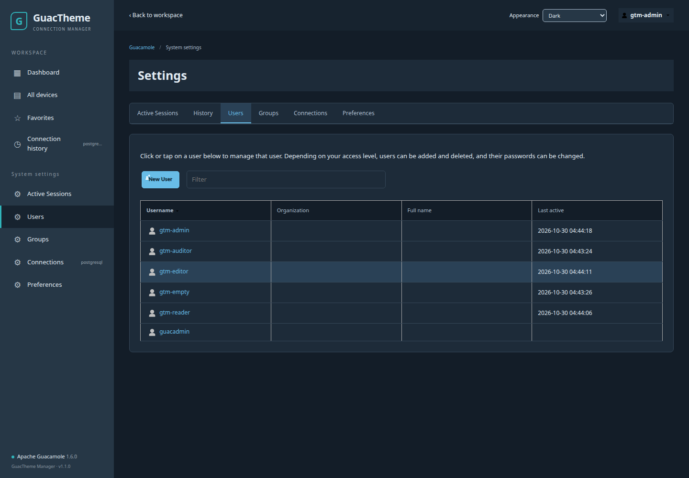

# 1.1.0 系統設定頁面交付與驗證

日期：2026-10-30（Asia/Taipei）。此版補齊系統設定與編輯頁的主題，使用同一組側欄、工具列、配色、表格與表單樣式。

## 頁面範圍

| 類別 | 完成內容 |
| --- | --- |
| 使用者 | 原生清單、搜尋、新增、帳號／密碼／權限編輯、儲存及刪除確認 |
| 使用者群組 | 原生清單、搜尋、新增、成員／權限編輯及刪除確認 |
| 連線管理 | 原生清單、篩選、連線參數編輯、群組編輯、分享設定編輯 |
| 連線歷史 | 原生查詢、排序、分頁及 CSV 下載 |
| 工作階段 | 原生工作階段清單、篩選及依權限終止連線的操作 |
| 偏好設定 | 原生語言、時區、近期連線、輸入及滑鼠選項；新增跨管理頁共享的個人外觀選單 |
| 連線匯入 | 原生檔案選擇／匯入流程及 CSV、JSON、YAML 格式說明 |

這些頁面沒有另外建立模擬資料來源或替代 API。原生 controller 繼續處理授權、驗證、儲存與刪除；主題只增加外框與樣式。設定側欄仍由原生使用者權限產生，普通使用者不會因此取得管理權限。

個人 LibreNMS、Dark、Light、Default 配色在首頁及各設定頁共用。Default 會還原原生設定版面，並保留小型外觀切換列。刪除與錯誤確認視窗的層級高於側欄／工具列；原生載入狀態由原本的 controller 管理，主題類別於 digest 完成後更新。

## 實際執行的測試

- **37 項 Python 測試、6 項 Node 模型測試通過**。新增 repository 更新的備份／替換測試，確認匯入新版時不會提前變更啟用中的 JAR。
- CLI 1.0.0 → 1.1.0 安裝升級、舊執行檔備份、拒絕非明確覆寫及卸載測試通過。
- 新建隔離 Docker 1.6.0 / guacd 1.6.0 / PostgreSQL 16 環境，**首頁 28 項、LibreNMS 設定頁 52 項、Dark 設定頁 52 項瀏覽器檢查全部通過**，共 132 項。
- 設定頁測試實際透過原生 API 完成：修改並恢復連線名稱、新增／刪除測試使用者及群組、新增／刪除連線群組、查詢資料庫中的合成歷史記錄及下載 CSV。
- 已檢查分享設定、匯入及說明頁載入，原生近期連線偏好保存、跨頁／重新整理後配色保存、Default 還原、390px 手機導覽、中文主題文字及無未處理／捕捉到的 Angular controller 錯誤。
- 隔離 Docker 的 switch、reset、restore、doctor、注入 readiness 失敗及 recover 均通過；PostgreSQL／guacd 容器 ID 與翻譯 fixture 校驗保持不變，測試專案完成後清理。

上述新增、刪除及連線參數修改只在隔離測試資料庫執行。正式部署不讀寫帳號、權限、連線或 PostgreSQL 資料。真實 RDP／SSH／VNC 握手與實際終止遠端工作階段仍需具備目標存取權的使用者驗收；本次未改動這些既有功能。

## 升級與還原

管理 CLI 可用 `scripts/install.sh --upgrade` 保存並更新既有 CLI。`guac-theme import ZIP --replace` 先備份主題 repository 複本，啟用中的 JAR 保持不變；最後 `switch librenms` 會另備份舊啟用狀態，僅重建 Web。舊版主題可透過該次 switch 的備份 ID restore。

套用後需在瀏覽器按 **Ctrl+Shift+R**，再進入系統設定，以載入新版合併 JavaScript、HTML patch 及 CSS。
